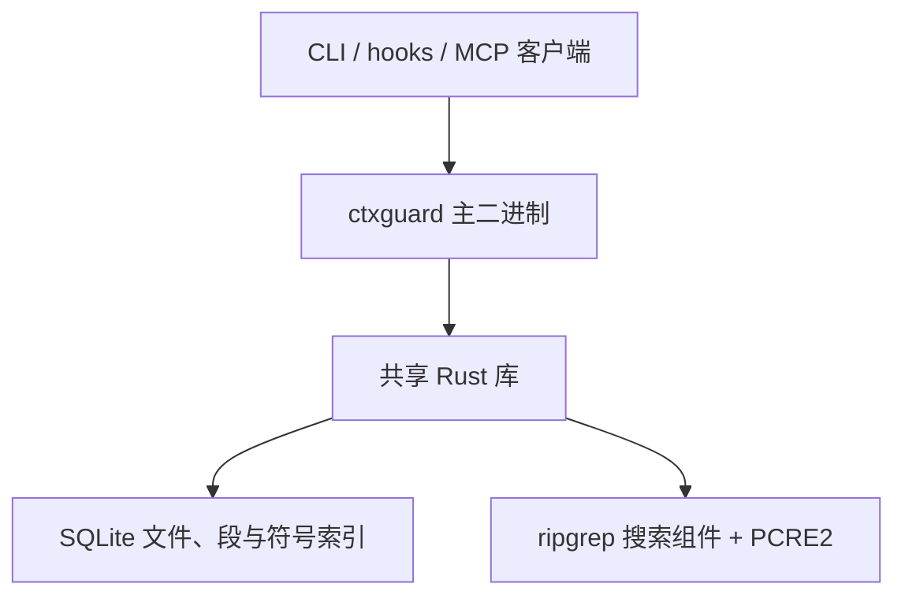

# ctxguard 的渐进式 Rust 迁移设计

> 状态：已确定迁移方向与搜索选型，尚未实现。更新：2026-11-13。目标读者：实现者。
> 待实现工作与后续候选集中记录在 [Future](future.md)；本文定义实现必须满足的契约。
> 本文档描述"把 ctxguard 逐步迁到 Rust"的切分方式、接口契约、迁移顺序与验收标准。
> **兼容行为是硬约束**：现有 145 项检查构成回归基线；改造测试驱动并移植内部测试，已接受的行为变化须单独记录。

## 0. 摘要

ctxguard 由 12 个平铺的 Python 模块组成（3,187 行），靠 `install.py` 复制散装 `.py` 投放，
由用户机器上的 `python3` 运行。2026-11 这一轮把它改造成 uv + ruff + ty 管理的工程之后，
暴露出一个根问题：

> **工具依赖一个用户机器上可能没有、或版本不对的 Python 解释器。**

围绕这个问题做出的所有工程措施——Python 版本下限、`install.py` 的解释器探测、
"找不到达标解释器就报错"、模块级标注在旧版本上求值崩溃导致 hook 静默放行——
全是治标。渐进迁移到 Rust 的意义不是性能，是**让这个根问题不再存在**。

**终局**：一个 Rust 二进制，承载全部功能（CLI / MCP / hook / 代理），
Python 依赖彻底消失。

**路径**：按职责切成 A–G 七个切片，逐片迁移。每片做成**库函数 + 薄 CLI**——库承载逻辑，
薄 CLI 只做参数解析与序列化；Python 侧探测到薄 CLI 就用、探测不到就走原实现兜底，
直到该片的 Python 实现退役。终局时主二进制把这些子命令整合进去，逻辑仍是同一份。

**性能是副产品，不是目标**：Rust 带来的"简单"（单文件、类型强制、无解释器）
才是迁移的主要收益。

## 1. 背景与证据

### 1.1 问题的来源

投放模型决定了运行时形态：`install.py` 把 11 个 `.py` 复制进 `<项目>/.claude/ctxguard/`，
hook 命令是 `python3 <dest>/hook_pre.py`，不建 venv、不装包。这保证了"复制即用"，
代价是运行时要一个解释器。

这个解释器带来一连串只能靠防御性代码兜住的问题：

| 问题 | 现状的应对 | 代价 |
|---|---|---|
| 用户 python3 版本过旧 | `requires-python = ">=3.13"` + `install.py` 探测解释器 | 探测逻辑 ~50 行；找不到就装不上 |
| 版本探测不到 | 报错退出，不留坏配置 | 装机失败是硬失败 |
| 导入期异常 | hook 的 `except Exception: return`（fail-open） | **约束静默失效**，用户毫无察觉 |
| 坏配置 | 项目/用户配置已有逐项校验，退回默认并警告；环境变量仍需核验 | Rust 侧继续显式校验，不能依赖强类型自动处理外部输入 |
| 类型错误 | 靠 ty + 标注（152 个函数目前只标了约 25 个） | 持续投入；漏标即漏检 |

fail-open 是这里最危险的默认：**工具"坏了"的表现是"什么都不拦"**，而不是报错。

### 1.2 历史量化基线（2026-11，Apple Silicon / Python 3.13.18）

以下为历史记录，本次评审未复测。搜索分项归因与当前代码存在出入，不能当作当前版本的性能承诺；
复测须记录提交、命令、语料、冷/热状态、实际搜索文件数与结果完整性。

| 指标 | 数值 | 说明 |
|---|---|---|
| hook 启动 | **27.2 ms**（其中 25.4 ms 是 `import lib, tools`） | 每次工具调用都付 |
| 索引 433 文件（npm 树） | 0.1 s | 典型小仓 |
| 索引 53,726 文件（Python 标准库） | **45.8 s**（0.85 ms/文件） | SessionStart 的预算是 25 s，**建不完，靠多会话续建** |
| search（53k 文件仓） | **21.4 s**，而代码里的预算是 15 s | **超时截断**，模型拿到的是残缺结果 |
| ├ 扫描（读文件 + 正则） | 9.7 s | 历史分项；须重测，不能预先归因于语言 |
| └ 命中文件 → 查段 | 9.7 s | 历史分项；当前仅为前 30 个排序结果查段，须重新定位成本 |
| 模块规模 | 12 个运行时模块 / 3,187 行 | lib 656、tools 639、backend_ts 403、hook_pre 357、install 337（2026-11-13 实测）|

### 1.3 一个与迁移无关、但立刻该修的问题

`_hit_chunks()` 调用 `chunks_for()` 时会重开 SQLite；但当前 `t_search()` 只为排序后的前 30 个文件查段，
不能推导为“14,000 个命中文件 = 14,000 次开库”。连接复用与批量查询值得验证，收益以重测为准。

当前 15 s 预算只覆盖扫描循环，不覆盖此前 refresh 与后续查段、渲染。输出已有“超时未搜完”提示，
但无命中时的“已搜索”计数使用的是总范围数，容易误导。后续应分别记录范围、实际已扫描数量和终止原因。

## 2. 目标与非目标

### 目标

1. **单个二进制**，承载 CLI / MCP / hook / 代理；用户机器不需要 Python。
2. **类型由编译器保证**，不再依赖"记得写标注"来换取静态检查。
3. **hook / MCP / CLI 共享同一份实现**，消除"三条路径行为不一致"的可能。
4. **部署退化为"复制一个文件"**，`install.py` 不再需要探测解释器、管理版本下限。
5. 保持**约定的兼容行为**：145 项现有检查作为回归基线，测试驱动适配新入口；PCRE2 与后端退役的差异单列验收。

### 非目标

1. **不追求极致性能**。Rust 会更快，但更快不是这次迁移的理由；不为性能牺牲行为一致性。
2. **不改产品形态**：仍然是"索引优先的读取约束"，三道闸的结构不变。
3. **不重写索引格式**：`.ctxindex/index.db` 的 SQLite schema 保持不变，它是 Python 与 Rust 之间的稳定接口。
4. **不追求一次到位**：任何时刻都存在一个可交付、可回退的状态。

## 3. 终局架构



- **一个 crate，两种 CLI 形态**（见 §3.2）：`ctxguard` 库承载全部逻辑，
  薄 CLI 只是"解析参数 → 调库 → 序列化"的适配器。
- **运行时 Python 全部退役**：安装与卸载同样由 Rust 实现；开发期脚本可以继续使用 Python。
- **CLI 表面保持不变**：子命令名、参数名、输出格式与现在的 `index.py` 逐字一致，
  现有 145 项检查需先适配启动驱动或移植内部断言，再验证新二进制（见 §6.3）。

### 3.1 lib + 薄 CLI：为什么这么切

每个切片都做成 **库函数 + 薄 CLI** 两层：

```
crates/ctxguard/
  src/lib.rs        # 库：分块、索引、扫描、hook 决策、MCP、代理——全部逻辑
  src/chunk.rs      # 切片 A
  src/index.rs      # 切片 B
  src/scan.rs       # 切片 C
  src/guard.rs      # 切片 E
  src/mcp.rs        # 切片 F
  src/cli/          # 切片 D：五个命令的实现
  src/bin/
    ctxguard-chunk.rs   # 薄 CLI（过渡期接口）
    ctxguard-scan.rs    # 薄 CLI（过渡期接口）
    ctxguard.rs         # 主 CLI（终局接口，子命令形式）
```

薄 CLI 只做三件事：解析参数 → 调库 → 序列化输出与退出码。收益：

1. **库可被单元测试直接调用**，不必起进程——Rust 侧的行为验证成本大幅下降
2. **过渡期与终局共用同一份逻辑**：薄 CLI 和主二进制调的是同一个库函数，
   不存在"两套实现"（这是渐进迁移最容易埋的坑）
3. **后期整合几乎免费**：终局的主二进制增加子命令即可，无需搬运逻辑；
   各片规模都不大（最大的分块器约 350 行），纯 CLI 拼装也足够简单
4. **对拍护栏可以在两侧同构地做**：Rust 侧对库函数断言，Python 侧对实现断言

**一个库，不拆多个 crate。** 切片是**模块**（`src/chunk.rs`、`src/scan.rs`……），
不是独立的 crate——它们不是各自独立发布的产品，共用一个版本号、一套 API、一条发布流水线。
多 crate 的版本协商、feature 组合与跨 crate API 演进对当前规模没有足够回报；不预估 Rust 行数作为验收条件。

因此"后期整合"具体就是**只重新封装上层**：

```
库（src/lib.rs + 各切片模块）—— 一行不改
  ↑
  ├─ 迁移期：src/bin/ctxguard-chunk.rs   薄 CLI，被 Python 调用
  └─ 终局：  src/bin/ctxguard.rs         主二进制，增加子命令即可
```

薄 CLI 变成主二进制的子命令（或直接删掉），**逻辑始终只有一份**。

唯一的例外是可选依赖：tree-sitter 只在声明提取后端需要，用 Cargo feature 控制
（`--features tree-sitter`），避免让 `ctxguard chunk` 这类薄 CLI 也背上它的编译与体积。
具体选哪个 crate（`tree-sitter` + 语言包绑定）留到实现时定。

### 3.2 外部约定与兼容边界

| 约定 | 内容 |
|---|---|
| 索引目录 | `<root>/.ctxindex/`，含 `index.db`（WAL）、`views/`、`stash/`、`backend.log` |
| SQLite schema | 见 §5.1，**迁移前后逐字相同** |
| 行号 | 1 基、闭区间；`chunks.s`/`chunks.e` 与 `symbols.line` 语义不变 |
| token 估算 | ASCII 约 3.6 字符/token，非 ASCII（中日韩）约 1 字符/token |
| 分块参数 | `MAX_CHUNK_LINES=120`、`MAX_CHUNK_CHARS=6000`、`MIN_CHUNK_LINES=15`、`LINE_CLIP=1000` |
| 文件类别 | `kind ∈ {code, doc, binary, huge}` |
| 配置来源 | 用户 `~/.ctxguard.json`、项目 `.ctxguard.json`、环境变量 `CTXGUARD_*` |
| 配置优先级 | 目标为环境变量 > 项目 > 用户 > 默认；现有部分数值变量在项目配置之前读取，须先补测试并显式修正；`backends` 安全例外见 §8.3 |
| MCP 协议 | JSON-RPC over stdio，`initialize` / `tools/list` / `tools/call`，5 个工具 |
| hook 协议 | PreToolUse 拦截 `Read`/`Grep`/`Bash`；拒绝时 exit 2 且 stderr 携带目录；SessionStart 注入目录概览 |
| 拒绝消息格式 | "拒绝原因 + 目录（起止行 | tokens | 标题 — 摘要）+ 下一步提示"，逐字不变 |
| 安装/卸载契约 | `.claude/settings.json` 的 hooks 结构、`.mcp.json` 的 mcpServers、`CLAUDE.md` 的标记块、`.gitignore` 条目——**装与卸必须严格互逆，且不碰用户自己写的内容**（由 tests/test_install.py 的往返测试钉住） |

## 4. 切片定义

每个切片是 **库函数 + 薄 CLI**（§3.2）。迁移期，分块和扫描等数据接口由 Python 通过 stdin/stdout 调用薄 CLI（扫描用 JSON；分块输入为原始 UTF-8 文本）。
Rust 模块之间直接调用库函数，不经 JSON 或子进程。终局，主二进制整合这些子命令。

**Python 决定"做什么"，Rust 只负责"怎么做"**——职责边界划在数据上，不在消息上，
这样跨语言不会产生行为分叉。

### 切片 A：分块器

| 项 | 内容 |
|---|---|
| 职责 | 把一份文本切成"带标题与摘要的段"（现在的 `lib.chunk_text` 及其启发式，约 350 行） |
| 接口 | `ctxguard chunk --ext <ext> [--json]`：stdin = 文件内容，stdout = JSON `[{s,e,tok,title,summary}]` |
| Python 侧 | `lib.chunk_text` 先 `shutil.which("ctxguard-chunk")` 探测；在则调用并解析 JSON，不在则用现有实现 |
| 退场条件 | 对拍 100% 一致后可启用；Python 启发式保留至最终切换，以维持 fallback |
| 依赖 | 无（最底层） |
| 形态 | 库函数 `core::chunk()` + 薄 CLI `ctxguard-chunk`（迁移期接口） |
| 风险 | **中**：启发式正则含前瞻，Rust 的 `regex` crate 不支持（见 §8.1） |

### 切片 B：索引器

| 项 | 内容 |
|---|---|
| 职责 | 遍历仓库 → 调 A 切片切段 → 写 SQLite（现在的 `lib.build`/`index_one`/`list_files`/`open_db`） |
| 接口 | `ctxguard build --root <dir> [--force] [--quiet] [--time-limit SEC]`，行为与现有 `index.py build` 一致 |
| Python 侧 | `lib.build` 优先调用兼容版本；不可用则走原实现 |
| 退场条件 | 索引库内容与 Python 实现逐行一致（§6.2） |
| 依赖 | A |
| 形态 | 库函数 `core::build()` + 子命令 `ctxguard build`（与现有 CLI 同名同参） |
| 风险 | 低（写库逻辑直白）；注意 `git ls-files` 的文件枚举与 `SKIP_DIRS` 剪枝要一致 |

### 切片 C：搜索引擎适配层（ripgrep + PCRE2）

| 项 | 内容 |
|---|---|
| 职责 | 复用 ripgrep 搜索组件，对给定文件清单查找匹配；不自行重写通用扫描引擎 |
| 依赖组件 | `grep-matcher`、`grep-searcher`、`grep-pcre2`；用户查询固定使用 PCRE2，不自动切换 Rust regex 或 fancy-regex |
| 接口 | 薄 CLI `ctxguard-scan --pattern <re> --json`，stdin 为含 root、files 与预算的请求；响应见 §5.5 |
| Python 侧 | `t_search` 决定文件清单与兼容参数；Rust 返回结构化命中，Python 映射到段并渲染 |
| 退场条件 | 兼容用例逐条一致；PCRE2 专有语法与已知差异单独验收；最终切换前保留 Python fallback |
| 依赖 | 不依赖 SQLite；只搜索调用方提供的文件清单 |
| 形态 | 库函数 `scan()` + 薄 CLI；主二进制直接调用同一库函数 |
| 风险 | 中高：Python re/PCRE2 语义差异、Unicode/换行、回溯资源限制、C 依赖链接与结果完整性 |

**职责边界**：ctxguard 决定范围、段映射、排序、输出预算与后续提示；搜索组件负责匹配与读取机制。
禁止让引擎按自己的默认 ignore/hidden 规则重新筛选清单。引擎的原始输出不直接返回模型。
先对完整的兼容行做规范化，再仅匹配每行前 2,000 个 Unicode 字符；不能先搜整行、事后丢弃晚于截点的命中，
否则 `$`、前瞻等语义会变化。`grep-searcher` 的 reader/buffer 与自定义 Sink/Matcher 适配在实现时验证，
如果不能直接表达上述逐行语义，则在适配层规范化输入并使用 PCRE2 Matcher，不复制通用引擎算法。

**部署**：使用库内嵌，不要求用户安装 `rg` 或 PCRE2 动态库。构建时需要 C 工具链；交付物需验证 PCRE2
随产物链接且不依赖用户额外安装的运行库。操作系统基础库依赖另行说明；JIT 可用则启用，不可用仍使用 PCRE2。
具体依赖版本、构建选项及锁定提交在实现时验证并固定，不能只凭 crate 名声称已实现静态部署。

### 切片 D：主 CLI

| 项 | 内容 |
|---|---|
| 职责 | `tree` / `outline` / `read` / `search` / `symbols` 五个命令（现在的 `tools.py` + `index.py`） |
| 接口 | 与现有 `index.py` 的子命令**逐字一致**（名字、参数、输出） |
| Python 侧 | 无（这是终态接口，不是被调用的） |
| 退场条件 | 适配后的行为套件全绿；内部测试移植，已接受差异按契约验收 |
| 依赖 | A、B、C |
| 形态 | 库函数 + 主二进制的子命令（`ctxguard tree` 等，参数与输出与现有 `index.py` 逐字一致） |
| 风险 | 中。工具注册表（现在在 `tools.py` 的 `TOOLS`）在 Rust 里同样是一张静态表——**单源原则照搬** |

### 切片 E：hook 决策

| 项 | 内容 |
|---|---|
| 职责 | Read / Grep / Bash 放行判断，以及 `hook_session.py` 的启动索引、概览注入和预算重置 |
| 接口 | `ctxguard guard`：stdin = hook payload，stdout = 决策与消息，exit 0（放行）/ 2（拒绝） |
| Python 侧 | 原 hook 保留到安装入口切换 |
| 退场条件 | 40 条 Bash 用例 + Read/Grep 用例逐条一致；**且** 拒绝消息逐字一致 |
| 依赖 | 读 SQLite（渲染目录）→ 依赖 B 的索引格式 |
| 形态 | 库函数 `core::guard()` + 子命令 `ctxguard guard`（读 stdin → 决策 → exit 0/2） |
| 风险 | **高**（见 §8.2），**因此排在最后**——但这是风险排序，不是"要不要做"的疑问：Rust 完全能实现它 |

### 切片 F：MCP 服务与代理

| 项 | 内容 |
|---|---|
| 职责 | `ctxguard mcp`（JSON-RPC over stdio）与 `ctxguard proxy -- CMD`（转发 + 大返回转存） |
| 接口 | 与现有 `server.py` / `proxy.py` 一致 |
| 退场条件 | MCP 五个工具的响应与代理行为一致 |
| 依赖 | D |
| 形态 | 库函数 `core::mcp()` / `core::proxy()` + 子命令 `ctxguard mcp` / `ctxguard proxy -- CMD` |
| 风险 | 低。长驻进程，启动开销无关紧要；**逻辑薄**，迁移收益主要在"少一个 Python 运行时" |

### 切片 G：安装与卸载

| 项 | 内容 |
|---|---|
| 职责 | 往目标项目写 `.claude/settings.json` / `.mcp.json` / `CLAUDE.md` / `.gitignore`，以及**撤销这些改动**（`ctxguard install` / `ctxguard uninstall`） |
| 接口 | `ctxguard install [项目] [--user] [--backend ...] [--wrap <名>]` 与 `ctxguard uninstall [项目] [--user]`；输出与现在的 `install.py` 一致 |
| 退场条件 | 现有 4 项安装/卸载往返测试（tests/test_install.py）指向新二进制后全绿 |
| 依赖 | D（要知道五个工具与 MCP 服务的名字） |
| 风险 | **中**：要精确复刻"合并而不是覆盖"的行为——用户自己的 hook、MCP 服务、CLAUDE.md 内容、.gitignore 规则都必须原样保留。当前 Python 版的语义由 tests/test_install.py 的四项往返测试钉住，Rust 版直接拿它当验收标准 |

与现在的差别只有一处实质：它要读写用户项目里的 JSON/Markdown 文件，
Rust 侧用 serde_json + 手写文本处理即可，不算难。

### 4.1 数据、协议与开发工具的处置

| 部分 | 理由 |
|---|---|
| `tools.py` 的配置与注册表 | 运行时实现迁到 Rust，配置契约与注册表单源原则保留 |
| `scripts/`（facts 同步工具） | 开发期工具，不进产物。但**迁移后必须跟着改**：`RUNTIME_MODULES` 从 12 个 Python 模块变成 1 个 Rust crate，文档里的行数/模块数口径全变（见 §6.3） |
| `server.py` / `proxy.py` 的 JSON-RPC 协议细节 | 协议行为保留，实现随 F 迁到 Rust |

## 5. 接口契约

跨切片、跨语言必须稳定的东西。**这些是 Rust 实现与 Python 实现之间的契约，任何改动都要同步改两侧并更新本节。**

### 5.1 SQLite schema（不变）

```sql
CREATE TABLE IF NOT EXISTS files(path TEXT PRIMARY KEY, size INTEGER, mtime REAL, kind TEXT,
                                 lines INTEGER, tok INTEGER, nchunks INTEGER);
CREATE TABLE IF NOT EXISTS chunks(path TEXT, idx INTEGER, s INTEGER, e INTEGER, tok INTEGER,
                                  title TEXT, summary TEXT, PRIMARY KEY(path, idx));
CREATE TABLE IF NOT EXISTS symbols(path TEXT, line INTEGER, name TEXT);
CREATE INDEX IF NOT EXISTS sym_name ON symbols(name);
CREATE INDEX IF NOT EXISTS sym_path ON symbols(path);
CREATE TABLE IF NOT EXISTS meta(k TEXT PRIMARY KEY, v TEXT);
```

`meta.sig` 存索引签名（`INDEX_VERSION` + 分块参数 + 后端签名）。后端迁到 tree-sitter 后，
签名内容会变——**旧索引必须自动失效重建**（现有机制已支持，改签名字符串即可）。

### 5.2 JSON 输出约定

- 编码 UTF-8，不转义非 ASCII（与现有 `json.dumps(..., ensure_ascii=False)` 一致）
- 段：`{"s": int, "e": int, "tok": int, "title": str, "summary": str}`，`s`/`e` 为 1 基闭区间
- 命中：`{"path": str, "lines": [{"n": int, "text": str}]}`
- 浮点：token 估算用整数；耗时等诊断数据不进协议输出

### 5.3 退出码

| 码 | 含义 |
|---|---|
| 0 | 成功 / hook 放行 |
| 1 | 用法错误（参数非法、路径不存在） |
| 2 | hook 拒绝（stderr 携带"拒绝原因 + 目录 + 下一步"） |

### 5.4 命令行表面

CLI 有两种形态，**逻辑只有一份**（都在库里，薄 CLI 与主二进制调同一个函数）：

| 形态 | 何时用 | 例子 |
|---|---|---|
| **薄 CLI**（独立可执行文件） | 迁移期：被 Python 侧调用 | `ctxguard-chunk`、`ctxguard-scan` |
| **主二进制**（子命令） | 终局：用户与 Claude Code 直接调用 | `ctxguard build tree outline read search symbols doctor compare chunk scan guard session-start mcp proxy install uninstall` |

主二进制的子命令表面**保持与现有 `index.py` 逐字一致**（子命令名、参数名、默认值、输出格式），
额外增加 `chunk` / `scan` / `guard` / `session-start` / `mcp` / `proxy` / `install` / `uninstall`。
测试需要适配入口；子命令兼容不等于测试脚本无需修改。

### 5.5 搜索契约与已接受的引擎变化

PCRE2 是用户查询的唯一正则引擎；分块器内部固定正则继续采用 §8.1 的 Rust regex 方案。
选择 PCRE2 不代表承诺完整模拟 Python `re`。公共语法保持命中一致；PCRE2 新支持的语法按 PCRE2 验收。
模式是否合法以 PCRE2 为准；编译语法错误保留旧版字面量回退策略，但必须显式标明回退，不能悄悄改变解释方式。

| 项目 | 目标行为 |
|---|---|
| 大小写 | 保留现有规则：原始 pattern 中出现任意 Unicode 大写字符则敏感，否则不敏感；显式设置 caseless，不直接使用引擎的 smart-case 推断 |
| 文本 | UTF-8 解码，非法序列替换为 U+FFFD；按现有 `split_lines` 语义逐行，无跨行匹配 |
| Unicode | 显式启用 UTF/UCP；用中文、组合字符、Unicode 边界与大小写折叠语料对拍，差异登记 |
| 行截点 | 每行前 2,000 个 Unicode 字符参与匹配，保留原始行文本用于结构化命中；行号为 1 基 |
| 命中上限 | 每文件最多 300 个命中行；同一行多次匹配仍是一条，达到上限标记为部分结果 |
| 非法模式 | PCRE2 语法编译失败时转固定字符串匹配，并返回 `effective_mode=literal` 与 `regex_fallback` 警告；正常模式为 `effective_mode=regex`。资源/内存错误不属于语法回退 |
| 范围 | 目录搜索保留现有 kind/size/path/glob 选择；显式文件的既有例外单独测试；引擎不得自行加默认忽略规则 |
| 输出 | 现有排序、auto/files/lines 选择及段提示保留；添加完整性提示是本次已接受变化 |
| 运行错误 | I/O、资源限制、PCRE2 匹配错误均须显式报告；不转字面量、不转其他引擎，也不伪装为无匹配 |

不引入 Python 正则解析器来分类任意模式。Python-only 模式可能触发带警告的字面量回退；
PCRE2-only 模式可能从旧版字面量变为真正正则。两类行为均纳入引擎差异语料与发布说明，
公共语法部分继续对拍；“保持行为”不能覆盖这两类已知例外。

扫描响应为单个对象，协议版本固定为 `1`：

```json
{
  "version": 1,
  "engine": "pcre2",
  "effective_mode": "regex",
  "warnings": [],
  "hits": [{"path": "src/main.rs", "lines": [{"n": 12, "text": "fn main() {"}]}],
  "scope_files": 100,
  "searched_files": 100,
  "complete": true,
  "stop_reasons": [],
  "errors": []
}
```

`searched_files` 仅计完整扫描的文件；跳过、半途终止或达到每文件命中上限的文件不计入。
`warnings` 包含稳定警告码与诊断信息；字面量回退必须渲染为可见提示。
`stop_reasons` 可包含 `timeout`、`match_limit`、`io_error`、`match_error`、`resource_limit`，
`errors` 含 path、稳定错误码与诊断信息。存在任一未完成范围时 `complete=false`；合法的零命中与不完整的零命中必须区分。
§5.2 的命中形状用于对象内的 `hits`；该 envelope 是新增内部接口，不改变现有 MCP 工具名字。

**资源预算**：一次查询编译一次 pattern，设置 PCRE2 match/depth（及可用的 heap）限制，并保留文件间 deadline。
文件间计时不能中止一次耗时的匹配，JIT 栈限制也不是总执行时间限制；必须验证所选组件能传递资源限制，
必要时用底层 PCRE2 绑定补适配。受限后返回明确的部分结果/错误。
首版不承诺硬墙钟超时；若需要硬超时，则由独立 worker 进程终止执行，此项放入 Future。

依赖依据：[grep-searcher](https://docs.rs/grep-searcher/)、[grep-pcre2](https://docs.rs/grep-pcre2/)、
[RegexMatcherBuilder](https://docs.rs/grep-pcre2/latest/grep_pcre2/struct.RegexMatcherBuilder.html)。

## 6. 迁移顺序与验收

### 6.1 每一步的 Definition of Done

| 步 | 内容 | 验收 |
|---|---|---|
| 0 | 测试入口适配、对拍护栏、兼容语料与基线复测 | 保留现有断言；按 §6.2/§6.3 分类，不把内部测试冒充黑盒 |
| 1 | 切片 A（分块器） | 对拍 100% 一致；现有 145 项测试全绿 |
| 2 | 切片 B（索引器） | 索引库三表与 Python 实现逐行一致；145 项全绿 |
| 3 | 切片 C（ripgrep + PCRE2）+ 验证连接复用 | 公共语法命中一致，PCRE2 差异有记录；完整性/资源错误正确；适用套件全绿 |
| 4 | 切片 D（主 CLI） | 主二进制成形（库 + 子命令）；**适配后的行为套件与移植后的内部测试全绿**；CLI 输出逐字一致 |
| 5 | 切片 F（MCP / 代理） | MCP 五个工具响应一致；代理转存行为一致 |
| 6 | 切片 E（两类 hook） | Bash/Read/Grep 与 SessionStart 用例一致；拒绝消息与预算重置正确 |
| 7 | 切片 G（安装与卸载） | 4 项装卸往返测试指向新二进制后全绿；用户自己的配置原样保留 |
| 8 | Python 侧退役 | 运行时零 Python；`scripts/facts.py` 的口径改成 Rust 工程；README 更新 |

切片 G 放在最后是**切换**动作：迁移期 Python 版 `install.py` 继续装 Python 版工具（切片 A–F
是它的可选加速件），G 落地后由 `ctxguard install` 装二进制版，Python 版才退役。

### 6.2 对拍护栏（步骤 0 的产物，必须先有）

一个脚本，对同一批输入跑两套实现，逐字段比对输出：

- **输入集**：`tests/gen_sample.py` 生成的样例仓库（覆盖 12 种语言与格式）
  + 真实 npm 源码树 + Python 标准库（2.8 万个 `.py`）
- **比对对象**（按切片）：
  - A：`chunk` 的 `s` / `e` / `tok` / `title` / `summary` **逐段逐字段**
  - B：`files` / `chunks` / `symbols` 三表**逐行**
  - C：公共语法的命中集合（path + 行号 + 文本）逐条；PCRE2-only/Python-only、错误与部分结果分别验收
  - D/E：命令输出**逐字节**
- **差异处理**：任何不一致都要归因到"实现差异"或"规格差异"。若规格本身不合理，
  先改规格（并同步改 Python 侧与本设计文档），再让两边一致——**不允许"改一边了事"**。

### 6.3 回归网

现在的测试分以下类别，迁移时处置各不相同：

| 类别 | 位置 | 迁移时怎么处置 |
|---|---|---|
| **行为与内部混合套件** | `tests/test_all.py`、`tests/test_backends.py` | 前者的 Python 启动命令需抽象为 CLI/hook/MCP/proxy 驱动；后者直接 import 模块并修改全局变量，内部断言移植为 Rust 单元测试，公共行为用适配驱动验证；pyast/插件专项随明确退役迁出 |
| **装卸往返** | `tests/test_install.py` | 指向新二进制的 `install` / `uninstall`，作为**切片 G 的验收标准** |
| **注册表自检** | `tests/test_registry.py` | 随实现语言迁移：现在盯的是 Python 的 `tools.TOOLS`，Rust 版要写等价的（盯 Rust 侧的注册表） |
| **文档闸门** | `tests/test_facts.py` | 留在 Python（开发期工具），但**迁移后必须跟着改**：`scripts/facts.py` 的 `RUNTIME_MODULES` 从 12 个 Python 模块变成 1 个 Rust crate，文档里的行数/模块数口径全变 |

> 保留适用的行为断言，适配驱动并移植内部测试；检查数量是现有基线，不是终局必须凑齐的数字。

需要额外补的是 Rust 自身的单元测试（并发、`unsafe`、整数溢出这些 Python 侧不存在的问题），
尤其是分块启发式（切片 A）——它目前只有间接覆盖。

## 7. 行为等价性机制

| 层次 | 手段 | 覆盖 |
|---|---|---|
| 外部行为 | 现有检查中适用的行为断言 + PCRE2 契约用例 | 端到端：hook 拒绝、MCP 响应、CLI 输出、索引一致性、预算、转存 |
| 切片行为 | 对拍护栏（§6.2） | 逐字段/逐行/逐字节 |
| 单元行为 | Rust 单元测试 + cargo test | 启发式边界、序列化、错误处理 |

## 8. 风险登记

### 8.1 分块器内部固定正则含前瞻（切片 A）——已评估：难度不大，改写即可

历史盘点的分块启发式固定正则只有 **3 处前瞻**（不包括用户搜索 pattern）；后顾、原子组、条件组、反向引用、`\Z`/`\A` 逐类查过，**均为 0 次**。
Rust 的 `regex` crate 只缺这 3 处：

| 位置 | 前瞻 | 语义 | 等价改写 |
|---|---|---|---|
| `lib.py` `_CTRL`（用于 `DECL_METHOD` / `DECL_C_SIG`） | `(?!\s*(?:if\|else\|...\|echo)\b)` | 行首不是控制关键字 | 正则只管"形状"，代码侧取"去空白后的首词"查集合 |
| `lib.py` `LEAD` 的 `#` 分支 | `#(?!\s*(?:include\|define\|...)\b)` | 以 `#` 开头但不是预处理指令 | 同上：首词查集合 |
| `lib.py` `_COMMENT_MARK` 的 `#+` 分支 | `#+(?=\s\|$)` | `#` 之后是空白或行尾 | 正则匹配 `#+`，代码侧查下一个字符 |

三处都**锚定在固定位置**（行首，或某个字面量之后），语义都是"看接下来的几个字符/词"，
因此都能表达成"正则匹配 + 一次代码侧的字符/词检查"。

**已验证**：在 2,902 行语料（7 个源文件的真实代码 + 32 条边界用例）上，
三处改写与原正则的判定**全部一致，0 处不一致**。

**分块器结论：改写，不引入 `fancy-regex`。用户搜索使用 PCRE2（§5.5），不受这里的内部正则选择限制。** 理由：

- 不引入回溯型依赖（`fancy-regex` 是回溯实现，长输入上可能退化）
- 改写后的逻辑是"词"级别的判断，比正则里的字符类更直白
- 代价只有十几行代码

对拍护栏（§6.2）负责在迁移过程中持续证明这个等价性——上面是一次性验证，
迁移期还要用它守住"Rust 实现 vs Python 实现"的等价。

附带的映射问题（同属"Python 标准库 → Rust"，但与前瞻无关）：
`fnmatch` 在 Rust 无内建等价物，需 `globset` 或手写匹配（`allow` 配置与 `--glob` 过滤用到）。

### 8.2 hook 的 Bash 分析语义（切片 E）

`hook_pre._segments()` 用 `shlex.shlex(cmd, posix=True, punctuation_chars=True)` 切分命令。
Rust 的 `shell-words` 等价物**没有** `punctuation_chars` 语义，切分结果会不同
（例如 `a&&b`、`a>b` 的边界）。这是全项目最容易出微妙差异的地方。

缓解：现有 40 条 Bash 用例（含 `cat > x.txt <<'EOF'`、`sudo`、`env FOO=1`、`2>/dev/null;`、
未闭合引号等边界）正好是现成的对照集，作为 Rust 侧的测试数据逐条移植。

### 8.3 明确的功能倒退（已决策接受）

1. **自定义 Python 后端插件作废**。现在支持 `plugin:/绝对路径.py` 与任意可导入模块名，
   用于声明提取后端。Rust 侧不做插件机制（若要保留，需走 dylib ABI，复杂度陡增）。
   连带作废的还有"项目级配置只接受内置后端名"这条安全策略（因为不再有插件可加载）。
2. **pyast 后端作废**，后端统一用 tree-sitter。代价：失去"零依赖的精确 Python 分块"
   （精确声明后端需要编译进 tree-sitter；启发式路径仍可独立构建）。收益：tree-sitter 原生支持 Rust，
   `backend_ts.py` 目前"只用假节点测过、真实语法节点名未实测"的状态可以在 Rust 侧一次性解决。
3. **声明提取后端的版本与选项**（`descend_functions`、`max_depth`）语义保持不变，
   但索引签名（`meta.sig`）会变 → 旧索引自动失效重建。

### 8.4 其他

| 风险 | 影响 | 缓解 |
|---|---|---|
| 分发：二进制要按平台构建 | macOS arm64/x86_64、Linux gnu/musl、Windows | 渐进期"可选安装"（见 §10）；终局由 CI 出多平台产物 |
| 行为漂移 | 模型看到的目录与拒绝消息变了 | 对拍护栏 + 适配后的行为套件；PCRE2 与退役后端的差异必须归因 |
| 迁移期双实现并存 | 代码量临时增加，看起来更复杂 | 明确这是**过渡态**；切片通过后启用 Rust，Python fallback 保留至 G 切换与最终验收后统一删除。薄 CLI 与主二进制共用同一个库，不产生第三份实现 |
| 树结构启发式的隐性知识 | `lib.py` 的 `_split_region` / `_merge` / `_windows` 逻辑微妙 | 迁移前先补 Python 侧的单元测试，把现有行为钉死 |
| 插件用户 | 少数依赖自定义后端的人会失去能力 | README 与发布说明明确告知，按已决策不新增 Python 插件桥接 |

## 9. 明确不迁的部分

见 §4.1。此外：

- **SQLite schema**：不变（§5.1）
- **索引目录布局**：不变（`.ctxindex/`）
- **MCP 工具的五个名字与语义**：不变
- **CLI 的子命令与参数**：不变
- **拒绝消息的文案与排版**：不变（逐字）

## 10. 分发与降级策略

### 10.1 渐进期：可选安装 + Python 兜底

需要跨语言调用的 Rust 切片提供薄入口，Python 侧探测可执行文件及协议/版本兼容性；Rust 内部不启子进程：

```
探测到 ctxguard-chunk  → 调它
探测不到                → 用 Python 实现
```

好处：
- **纯 Python 用户完全不受影响**——不需要装任何东西，行为不变
- 迁移可以任意暂停或回退
- 分发问题被降级成"可选安装"，不必一次解决
- 一个 crate 统一版本，薄 bin 可分别安装；不存在切片独立发版与版本协商
- 缺少或版本不兼容时使用 Python fallback；Rust 已开始执行后遇到查询/文件错误，必须上报，不静默换引擎
- 只有最终切换完成才统一删除 Python fallback，避免纯 Python 用户被中途破坏

### 10.2 终局

全部迁完后：
- `ctxguard install` / `ctxguard uninstall` 取代 `install.py`：前者"复制一个二进制 + 写配置"，
  后者把前者做的事原样撤回
- `install.py` 退役（过渡期保留，Python 版工具仍靠它安装）
- Python 版本下限、解释器探测、导入失败 fail-open 那一整套**全部删除**
- PreToolUse 为 `ctxguard guard`，SessionStart 为 `ctxguard session-start`，MCP 为 `ctxguard mcp`
- PCRE2 随交付物链接；“无解释器”不等于没有操作系统基础库，构建与交付验证见 Future

### 10.3 关于"打包"

此前评估过用 PyInstaller / Nuitka 把 Python 侧打成二进制（同样能消除解释器依赖）。
**本次不走这条路**——它不解决"类型由编译器保证"和"单一实现"，只是换了个分发方式。
Rust 迁移顺带解决这两点，所以不再单独做 Python 打包。

## 11. 迁移前可独立收获的改进（与 Rust 无关）

待实现条目集中见 [Future](future.md)，本节只说明前置依赖：

1. 复测 §1.2 的历史基线，核验连接复用收益；不承诺未经测量的“21.4 s → 12 s”。
2. 保留已有超时提示，补实际已扫描数与终止原因，不把部分结果称为完整结果。
3. 补分块启发式与搜索兼容语料，再改造测试驱动，之后开始 A/C 实现。

## 12. 已决策与待定

### 已决策（2026-11）

| 决策 | 内容 |
|---|---|
| D1 | 渐进迁移到 Rust，不做一次性重写 |
| D2 | 切分为 A–G 七片，按“可交付、可回退”推进；JSON 仅用于 Python/Rust 数据进程边界，Rust 模块直接调库 |
| D3 | **接受自定义 Python 后端插件作废** |
| D4 | **后端统一用 tree-sitter**，pyast 后端作废 |
| D5 | 性能不是目标，单一实现与无解释器依赖才是 |
| D6 | 兼容行为是硬约束；现有检查按行为/内部断言分类移植，PCRE2 与后端退役例外显式验收 |
| D7 | 先写设计文档，评审后再开工 |
| D8 | 每个 Rust 片都是**库函数 + 薄 CLI**；薄 CLI 只做参数解析、调用、序列化，后期整合即"加子命令" |
| D9 | 后端不设"Python 子进程过渡"方案——迁移方向已决定它（见下） |
| D10 | 三处正则前瞻**改写**为"匹配 + 代码侧检查"，不引入 `fancy-regex`（已验证等价，§8.1） |
| D11 | 暂不做 OS 绑定：多平台产物是 future，当前只保证开发机可跑 |
| D12 | 拒绝消息的渲染放进 Rust **库**——薄 CLI 与主二进制共用同一份格式定义 |
| D13 | 依赖策略：有成熟的同类 crate 就用，没有才手写；单 crate 单 lib（切片是模块，不是独立 crate），集成时只重新封装上层，库不动 |
| D15 | 搜索复用 ripgrep 库，用户正则固定 PCRE2；范围、段映射和输出预算由 ctxguard 管理；tgrep/fff 仅为 Future 候选 |
| D16 | Python fallback 保留至最终切换；运行时错误显式报告，不静默降级到其他引擎 |
| D14 | **安装与卸载一并迁到 Rust**（新增切片 G，排在迁移顺序最后）。原判"install.py 留在 Python 最省事"是错的：卸载是同一个安装的另一半，终局用户手里是二进制，卸载却要跑 Python 脚本，"用户机器不需要 Python"就落不了地 |

### 待定

**依赖策略（通用）**：**有成熟的同类 crate 就用，没有才手写**。手写只在没有合适 crate
或现成 crate 的语义与 Python 原生库差太多、适配成本高于自己写时采用。

（原 Q1 / Q3 / Q5 / Q6 已关闭，结论见下。）

### 已关闭的问题（不再是决策点）

| 原编号 | 结论 | 理由 |
|---|---|---|
| Q2 | 后端是否保留 Python 子进程过渡？ | **不是决策点。** 迁移方向是 Python → Rust，"后端用 Python 还是 Rust"完全由 Rust 侧的实现进度决定：Rust 的 tree-sitter 后端落地之前，Python 后端就是唯一实现；落地之后它就是历史。中间态是迁移过程的自然产物，不需要预先设计过渡方案——为它设计接口反而是给自己加活。 |
| Q3 | 二进制的多平台产物由谁出？ | **暂不做 OS 绑定**（D11）。多平台产物是 future：迁移期的形态是"作者本机可跑的 Rust 片 + Python 兜底"，不承诺任何用户都能拿到二进制。终局要面向大众时再解决——届时 CI 出多平台产物是标准做法。 |
| Q4 | 切片 E 的 hook 是否值得迁？ | **要迁。** Rust 完全能实现它（读 SQLite 渲染目录、复刻 shlex 的切分语义、复刻拒绝消息格式），没有技术障碍。它排在最后是**风险排序**——shlex 的 `punctuation_chars` 语义最容易出微妙差异、而 fail-open 的行为又很敏感——不是"要不要做"的疑问。 |
| Q6 | `fnmatch` 的 Rust 映射：用现成 crate 还是手写？ | **用现成的**（D13）。`globset` 是 Rust 生态里对应 `fnmatch` 的成熟 crate（ripgrep 也在用）。但**不能直接替换**——`fnmatch.fnmatch` 有两个语义要复刻：① 它对 name 和 pattern **都**过 `os.path.normcase`——Windows 上该函数转小写（故大小写不敏感），POSIX 上是恒等（故敏感）；`fnmatchcase` 才始终敏感。② Python 的 `*` 翻译成 `.*`，**跨 `/` 匹配**（`fnmatch('docs/a/b.py', '*.py')` 为真）。这两点与 globset 的默认行为（`case_insensitive`、`literal_separator`）都需要逐项对齐。实现时要在 lib 里包一层，把这些语义钉死，并用对拍护栏验证。 |
| Q5 | 是否把"拒绝消息渲染"也放进 Rust？ | **放进库**（D12）。消息格式（"拒绝原因 + 目录 + 下一步"）是库的一部分，薄 CLI 与终局主二进制共用同一份定义——**这比现在更安全**：现在 `outline_text` 只在 Python 侧有一份，Rust 化后格式定义随库走，不存在两份。 |

## 附录 A：Rust 工程布局

```
crates/ctxguard/
  Cargo.toml
  src/
    lib.rs           # 库入口；类型定义、token 估算、各切片的公开 API
    chunk.rs         # 切片 A：分块启发式
    index.rs         # 切片 B：索引
    scan.rs          # 切片 C：扫描
    guard.rs         # 切片 E：hook 决策
    mcp.rs           # 切片 F：MCP 服务
    proxy.rs         # 切片 F：代理
    cli/             # 切片 D：五个命令（注册表单源）
  src/bin/
    ctxguard-chunk.rs   # 薄 CLI：解析参数 → core::chunk → 输出 JSON
    ctxguard-scan.rs    # 薄 CLI：解析参数 → core::scan  → 输出 JSON
    ctxguard.rs         # 主 CLI：子命令分发 → 同一个库
  tests/                # Rust 单元测试 + 移植的 Bash 用例
tools/parity.py         # 对拍护栏（§6.2）
```

- **一个 crate，多个 bin**：Cargo 自动发现 `src/bin/*.rs`，每个都是薄适配器，
  共享 `ctxguard` 库。`cargo install --path crates/ctxguard` 可全装或按 `--bin` 选装。
- **薄 CLI 与主二进制调的是同一个库函数**——过渡期与终局不存在两份实现。
- Python 侧的目录结构在迁移完成前保持不变（12 个平铺模块 + `tests/`）。

## 附录 B：现状与终局的对照

| 维度 | 现状 | 终局 |
|---|---|---|
| 运行时依赖 | Python 3.13+（用户机器） | 无 Python/外部 rg；PCRE2 随产物链接，OS 基础库依赖需验证 |
| 投放物 | 11 个 `.py` + 配置 | 1 个二进制 + 配置 |
| 类型检查 | ruff + ty（靠标注自觉） | 编译器强制 |
| hook / MCP / CLI 实现 | 三处（tools.py 共享工具层，但入口各自拼装） | 一处 |
| 解释器探测 | install.py ~50 行 | 无 |
| 导入失败 fail-open | 存在（已修一处） | 不存在（无导入期） |
| 坏配置 | 项目/用户项退回默认 + 警告 | 保持显式校验、默认回退与告警；不因换语言直接改为硬失败 |
| search（53k 文件） | 21.4 s（超时截断） | 目标 < 3 s |
| hook 延迟 | 27.2 ms | 目标 < 5 ms |
| 索引（53k 文件） | 45.8 s（建不完） | 目标 < 12 s |

性能目标属于待复测目标，不是已达成指标。后续工作统一见 [Future](future.md)。
